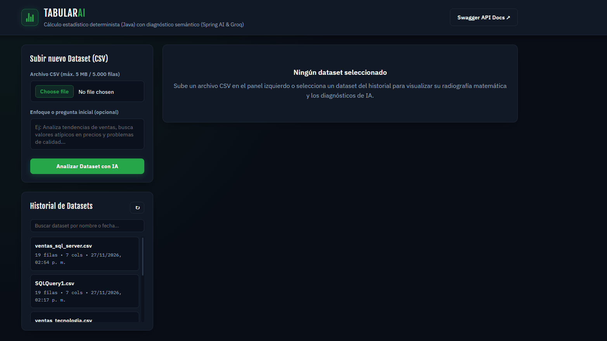
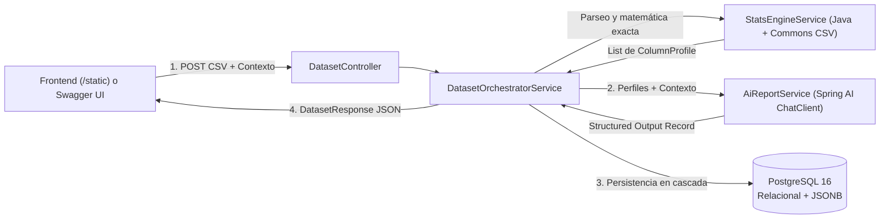
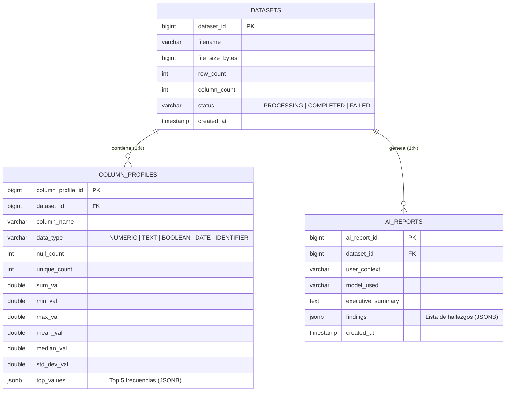

# TabularAI — Motor Inteligente de Análisis de Datasets (Spring Boot + Spring AI)

**TabularAI** es una aplicación web full-stack construida con **Java 21**, **Spring Boot 4** y **Spring AI** que procesa archivos de datos tabulares (`.csv`) para generar un perfil estadístico determinista de alta precisión y múltiples diagnósticos semánticos impulsados por Inteligencia Artificial.

---

## Demostración Interactiva

<!-- Reemplaza la ruta de abajo con tu GIF grabado (por ejemplo: docs/demo.gif) -->
> **[ESPACIO PARA GIF DEMOSTRATIVO]**
>
> 

---

## ¿Por qué separar el cálculo determinista de la IA?

Enviar un archivo CSV crudo de miles de filas directamente a un LLM es **costoso en tokens, lento y propenso a alucinaciones matemáticas**.

**TabularAI** aplica un principio de arquitectura de software con IA: **separar el cálculo matemático determinista de la interpretación semántica**:

1. **Motor Determinista (`StatsEngineService` — Java + Apache Commons CSV):**
   * Parsea el archivo en memoria RAM, autodetecta el delimitador (`,`, `;` o `\t`), limpia marcas `UTF-8 BOM` y normaliza decimales con punto o coma.
   * Clasifica automáticamente cada columna (`NUMERIC`, `TEXT`, `BOOLEAN`, `DATE`, `IDENTIFIER`) diferenciando claves primarias (PK) de claves foráneas (FK).
   * Calcula métricas exactas: **Total (Suma), Mínimo, Máximo, Promedio (Mean), Mediana (Median), Desviación Estándar, conteo de Nulos/Únicos y Top 5 de Frecuencias** (agrupando timestamps por día).
2. **Motor Semántico (`AiReportService` — Spring AI + Groq):**
   * Consume **únicamente los perfiles estadísticos ya calculados por Java** (~350 tokens por petición en lugar de >100.000 tokens del CSV crudo).
   * Utiliza **Structured Outputs** (`.entity(AiInsightsDto.class)`) para obligar al LLM a responder bajo un esquema JSON estricto mapeado directamente a un Java `Record`.
   * Permite generar **múltiples reportes con distintos enfoques** sobre un mismo dataset reutilizando los perfiles guardados en PostgreSQL sin volver a subir ni reprocesar el archivo.

---

## Stack Tecnológico

| Categoría | Tecnología | Rol en el Proyecto |
| :--- | :--- | :--- |
| **Lenguaje** | Java 21 | Uso de `Records` inmutables para DTOs, Streams y Pattern Matching. |
| **Framework Backend** | Spring Boot 4.1 | API REST (`@RestController`), validación (`Jakarta Validation`) y manejo de errores RFC 7807 (`ProblemDetail`). |
| **Integración IA** | Spring AI 2.0 (`ChatClient`) | Conexión con **Groq** (`openai/gpt-oss-120b`), *Prompt Templates* y *Structured Outputs*. |
| **Motor CSV** | Apache Commons CSV | Lectura tolerante a fallos con autodetección de separadores (`,` / `;` / `\t`). |
| **Base de Datos** | PostgreSQL 16 | Modelo híbrido: tablas relacionales (`1:N`) combinadas con columnas nativas `JSONB`. |
| **Persistencia / ORM** | Spring Data JPA + Hibernate | Relaciones bidireccionales en cascada (`CascadeType.ALL`) y mapeo `@JdbcTypeCode(SqlTypes.JSON)`. |
| **Documentación API** | Springdoc OpenAPI 3 (Swagger) | Interfaz interactiva en `/swagger-ui/index.html` para probar todos los endpoints. |
| **Frontend** | HTML5 + CSS3 + Vanilla JS (`fetch`) | Dashboard moderno desacoplado servido desde `src/main/resources/static`. |
| **Testing** | JUnit 5 + Mockito | Pruebas unitarias del motor estadístico, orquestador y generación de contratos OpenAPI. |
| **Infraestructura** | Docker & Docker Compose | Despliegue reproducible de PostgreSQL 16 con volumen persistente. |

---

## Arquitectura del Sistema



### Modelo Entidad-Relación (PostgreSQL)



---

## Contrato de Endpoints (API REST)

| Método | Ruta | Descripción | Respuesta |
| :--- | :--- | :--- | :--- |
| `POST` | `/api/v1/datasets` | Recibe `file` (CSV) y `context` (opcional). Calcula los `column_profiles`, genera el primer `ai_report` y persiste todo. | `201 Created` |
| `GET` | `/api/v1/datasets` | Lista paginada del historial de datasets cargados (solo metadatos). | `200 OK` |
| `GET` | `/api/v1/datasets/{id}` | Devuelve el dataset completo con todos sus `columnProfiles` y `aiReports`. | `200 OK` |
| `POST` | `/api/v1/datasets/{id}/reports` | Genera un **nuevo reporte de IA** con otro enfoque sobre un dataset existente sin volver a subir el CSV. | `201 Created` |
| `DELETE` | `/api/v1/datasets/{id}` | Elimina un dataset y en cascada todos sus perfiles y reportes asociados. | `204 No Content` |

---

## Cómo ejecutar el proyecto localmente

### Prerrequisitos
* **Java 21** (o superior)
* **Docker Desktop** (para levantar PostgreSQL 16)
* Una **API Key gratuita de Groq** ([Crear cuenta y API Key en GroqCloud](https://console.groq.com/keys))

### 1. Clonar el repositorio
```bash
git clone https://github.com/tu-usuario/tabularai.git
cd tabularai
```

### 2. Configurar la API Key de Groq
Copia el archivo de ejemplo `.env.example` como `.env` en la raíz del proyecto y coloca tu clave de Groq:
```bash
cp .env.example .env
```
Contenido de `.env`:
```properties
GROQ_API_KEY=gsk_tu_clave_real_aqui
```

### 3. Levantar PostgreSQL con Docker
```bash
docker compose up -d
```

### 4. Iniciar la aplicación Spring Boot
En Windows (PowerShell):
```powershell
.\mvnw.cmd spring-boot:run
```
En Linux / macOS:
```bash
./mvnw spring-boot:run
```

### 5. Explorar la aplicación
* **Dashboard Web:** [http://localhost:8080](http://localhost:8080)
* **Swagger UI (OpenAPI Docs):** [http://localhost:8080/swagger-ui/index.html](http://localhost:8080/swagger-ui/index.html)

> **Archivos CSV de prueba incluidos:** En la carpeta [`/samples`](./samples) encontrarás 3 archivos listos para probar distintos escenarios:
> * `ventas_tecnologia.csv`: CSV estándar separado por comas con valores atípicos y celdas vacías.
> * `ventas_sql_server.csv`: Exportación real de SQL Server separada por `;`, con decimales con coma, literales `NULL`, claves foráneas y timestamps con milisegundos.
> * `metricas_clientes_saas.csv`: Dataset de suscripciones SaaS para análisis de retención (*churn*) y facturación.

---

## Ejecutar Pruebas Unitarias

```powershell
.\mvnw.cmd test
```
